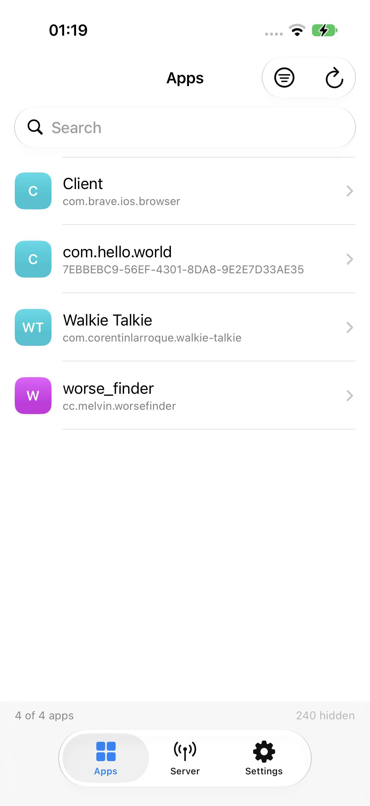
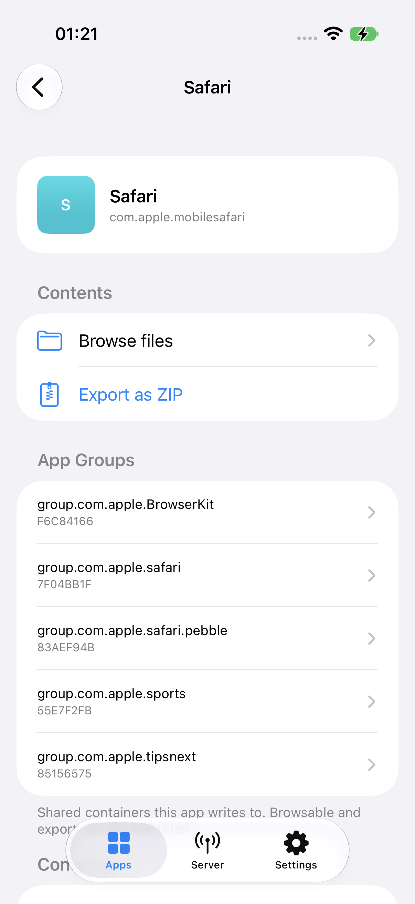
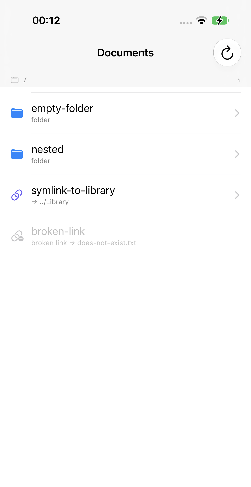
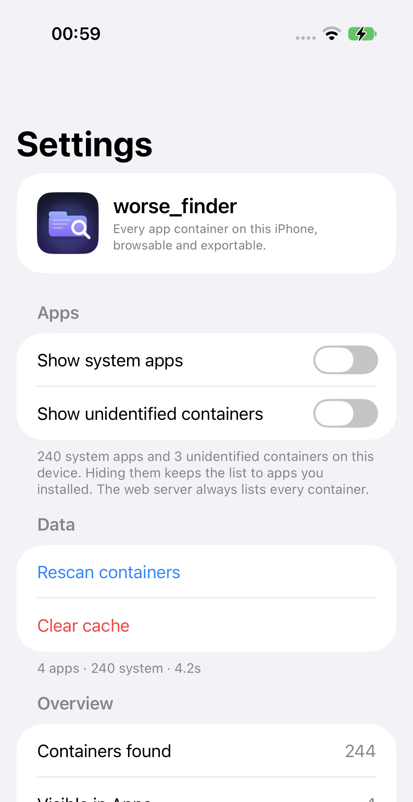

<p align="center">
  
</p>

<h1 align="center">worse_finder</h1>

<p align="center">
  Browse and export the data containers of every app on an iPhone.<br>
  No jailbreak, no kernel exploit, just a symlink the container manager follows.
</p>

<p align="center">
  
  
  
</p>

---

## What this is

worse_finder lists every app's data container on an iOS 26 or 27 device, opens it like a
folder, and exports it as a ZIP. App Group containers are reachable too, and on iOS 27 so are
some system containers.

The escape comes from [`worse_query`](https://github.com/forcequitOS/worse_query). An app that
holds an App Group entitlement can replace its group's `Library/Caches` with a symlink, then ask
`containermanagerd` for a sandbox extension on that path. The manager resolves the symlink and
issues the extension for the target without checking that the target is still inside the
container. The app consumes the token and the sandbox covers whatever it points at.

No kernel bug is involved, and iOS 27.2.1 does not patch it. [`docs/technique.md`](docs/technique.md)
has the writeup: container manager internals, the CSStore2 record layout used to name apps, and
what iOS blocks and what it does not.

## Features

- **App list.** Every data container on the device, named through lsd's LaunchServices store and
  `LSApplicationProxy`. System apps are hidden by default and can be shown from Settings.
- **File browser.** Folders, sizes, dates, symlinks with their targets, broken links flagged,
  and explicit messages for denied or vanished paths.
- **ZIP export.** Streaming deflate with ZIP64. File and byte counts are checked against a
  directory walk. Archives land in the app's Documents, ready for AirDrop or Files.
- **App Groups.** The shared containers each app writes to, browsable and exportable like any
  other.
- **Web server.** The same features over HTTP on port 8080, behind a generated three-word
  passphrase, so you can pull a container off the phone from a laptop.
- **Settings.** Show system apps, show unidentified containers, rescan, clear the cache.

## Screenshots

| | |
|---|---|
|  |  |
| Apps you installed. System containers stay hidden. | Safari, with its App Groups and export |
|  |  |
| Inside Safari's container | What the scan found, and what stays hidden |

## How it works

```
app group Library/Caches  ──symlink──▶  any path
        │
        ▼
container_query(class 7, part 3)  ──▶  containermanagerd resolves the part
        │
        ▼
container_copy_sandbox_token()    ──▶  token for the resolved target
        │
        ▼
sandbox_extension_consume()       ──▶  read-write on that path
```

The escape itself is one function in `worse_finder/Escape.m`. The rest is the app on top of it:
`LSStore.m` parses lsd's `bdsl` CSStore to turn container UUIDs into bundle IDs, `MCM.m` reads
names and App Groups from LaunchServices, `ZipWriter.m` writes the archives, and `Store.swift`
with `Server.swift` does the rest.

## Build

Xcode 27, deployment target iOS 26.0. The app needs an App Group, since that is the mechanism,
and it will not work without one.

1. Open `worse_finder.xcodeproj`, select the target, then Signing & Capabilities.
2. Set your team, add the App Groups capability, and create a group.
3. Point `worse_finder/worse_finder.entitlements` at that group.
4. Change the bundle ID if you like. `com.example.worsefinder` is a placeholder.

Then:

```sh
xcodebuild -project worse_finder.xcodeproj -target worse_finder -configuration Debug \
  -sdk iphoneos -allowProvisioningUpdates build

xcrun devicectl device install app --device <udid> build/Debug-iphoneos/worse_finder.app
```

Sideloading tools that drop the App Group entitlement, such as Sideloadly or wildcard profiles,
produce an app that reports "no accessible App Group" on every screen. Use a signer that keeps
the entitlement.

## Debug flags

Pass them as launch arguments, for example
`xcrun devicectl device process launch --console <bundle> --serve`.

| flag | effect |
|---|---|
| `--serve` | start the HTTP server at launch and print every address |
| `--server-tab`, `--settings-tab` | open on that tab |
| `--app <bundleID>` | push an app's detail page |
| `--browse-path <path>` | open the file browser on a path |
| `--show-system` | start with system apps visible |
| `--fixture` | write symlink, broken-link, empty and nested fixtures into Documents |
| `--fixture-check` | print what the browser model sees for those paths |
| `--export-check` | export empty, nested and 56 MB containers, then run a cancel test |
| `--walkie` | report every container for one bundle |
| `--empty` | force the Apps empty state |

## Limitations

- **Icons are not available.** Inside the sandbox `iconDataForVariant:` returns the same 16 KB
  placeholder for every bundle ID. The real artwork sits in an IconServices asset store that
  needs its own parser, so rows fall back to gradient initials.
- **This is not a jailbreak.** It gives read-write access to containers, not code execution
  outside the app.
- **The web server speaks plain HTTP.** The passphrase crosses the network in clear text, and
  anyone who has it can read every container the phone can reach.
- **Exports are copies.** Large containers take time and disk space, because the archive is
  written inside the app's container before you share it.

## Credits

- [`worse_query`](https://github.com/forcequitOS/worse_query), by Taj C (forcequit) and
  0xjohnny. The escape, and the `pathleak` inode enumeration idea.
- [WQ Files](https://github.com/kolbicz/WQFiles), which reverse engineered the CSStore2 record
  layouts this app parses.
- The icon is generated with PIL. The script is in `docs/icon.py`.

## License

GPL-3.0, the same license as `worse_query` and WQ Files, whose code and layout knowledge this
builds on.

This edits files iOS normally keeps out of reach. Back up the device before you point it at a
container you care about.
